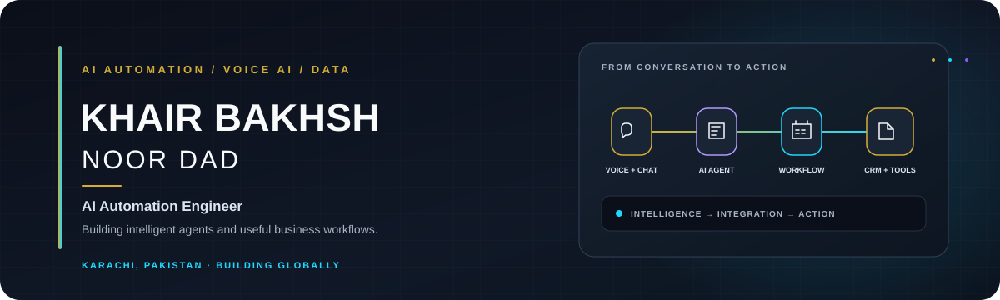
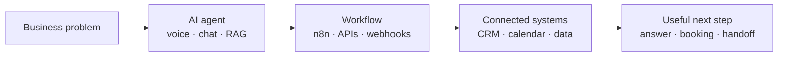
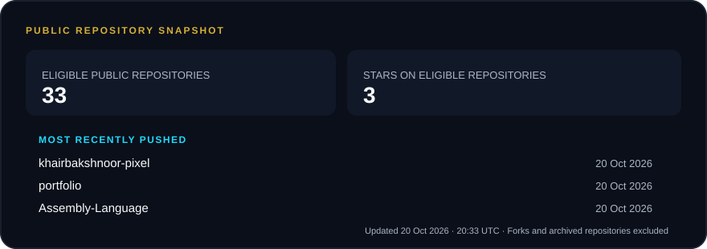
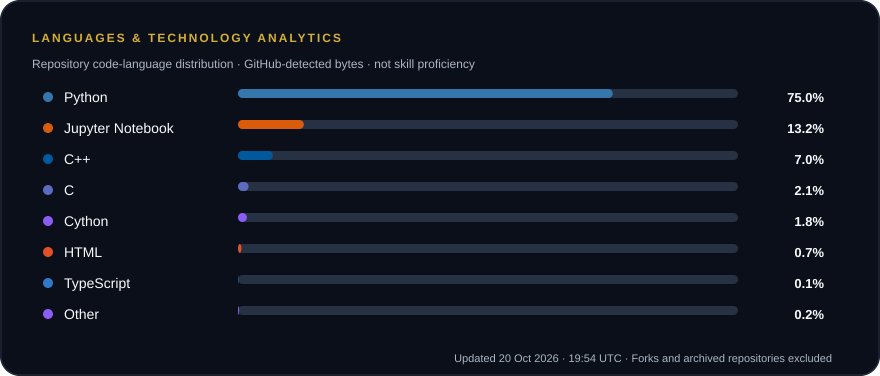

  

  <a href="https://portfolio-delta-hazel-74.vercel.app/">Portfolio</a>
  &nbsp;·&nbsp; <a href="https://linkedin.com/in/khair-bakhsh-54714b339">LinkedIn</a>
  &nbsp;·&nbsp; <a href="https://github.com/khairbakshnoor-pixel">GitHub</a>
  &nbsp;·&nbsp; <a href="mailto:khairbakshnoor@gmail.com">Email</a>

  <strong>AI Automation Engineer</strong> &nbsp;·&nbsp; Voice AI &nbsp;·&nbsp; Conversational systems &nbsp;·&nbsp; Data & ML

  

---

### About

I build practical AI agents and business automations that move work forward: answering customer questions, qualifying leads, collecting onboarding details, and connecting the next step to the right tool. My work spans voice and chat, workflow orchestration, CRM/API integrations, and knowledge-grounded assistants. I bring a data and machine-learning foundation to each build: understand the problem, test real scenarios, and keep the system useful and clear.

| Quick facts |  |
| --- | --- |
| **Education** | BS Computer Science · SZABIST University, Karachi · CGPA 3.66 / 4.00 |
| **Based in** | Karachi, Pakistan · Building with a remote, US-facing team |
| **Current focus** | Voice agents, n8n automations, RAG, and connected business systems |
| **Open to** | Meaningful collaborations in AI automation and software engineering |

### Engineering intelligent automation

From voice-based lead qualification and appointment scheduling to CRM synchronization and knowledge-based support, I focus on the complete path from a real need to a reliable next action—not just a model or demo in isolation.

### Selected projects

Eight curated public projects. “Live” means the linked public demo was reachable when checked; source-only projects are not presented as deployed. Project progress percentages are intentionally omitted because repository activity is not a completion measure.

| Project | Problem & approach | Technology | Source | Status |
| --- | --- | --- | --- | --- |
| **AI client onboarding** | Collects client details through chat or voice and routes structured information into business workflows. | Claude API, Retell AI, n8n, CRM integrations | [Code](https://github.com/khairbakshnoor-pixel/Client-Onboarding-Website) | [Live demo](https://ai-call-bykb.vercel.app/) |
| **Face recognition attendance** | Educational face-matching attendance project with a separate visual showcase. | Python, OpenCV, Streamlit, SQLite | [Code](https://github.com/khairbakshnoor-pixel/Attendance-Machine) | [Live showcase](https://facedetectore.vercel.app/) |
| **Crypto analytics platform** | Ingests market data, stores a SQLite snapshot, and presents an interactive dashboard. | Python, Streamlit, SQLite, CoinGecko API | [Code](https://github.com/khairbakshnoor-pixel/Real-Time-Crypto-Analytics-Platform) | [Live app](https://real-time-crypto-analytics-platform-axuqpnotjnurzdnuyfvexv.streamlit.app/) |
| **Engineering website chatbot** | Answers engineering-services questions and routes website visitors toward a useful team handoff. | HTML, JavaScript, conversational AI | [Code](https://github.com/khairbakshnoor-pixel/Gregs-ChatBot-1) | Source only |
| **Customer churn dashboard** | Compares six machine-learning models and explores customer churn patterns. | Python, scikit-learn, Pandas, Plotly | [Code](https://github.com/khairbakshnoor-pixel/Customer-churn-dashboard-) | Demo unavailable |
| **Insurance claim co-pilot** | Hackathon demonstration of explainable claim review with a human decision step. | Python, TensorFlow, Streamlit, SHAP | [Code](https://github.com/khairbakshnoor-pixel/-AI-Insurance-Claim-Co-Pilot) | Source only |
| **Machine-learning studies** | Notebook projects exploring prediction, lending, and data analysis. | Python, Pandas, scikit-learn | [Code](https://github.com/khairbakshnoor-pixel/MACHINE-LEARNING-PROJECTS) | Source only |
| **AI data analysis challenge** | A hackathon project for CSV summaries, deterministic question answering, and chart generation. | Python, data analysis, AI | [Code](https://github.com/khairbakshnoor-pixel/SMIT-HACKHATHON) | Source only |

See the [full portfolio and case studies](https://portfolio-delta-hazel-74.vercel.app/) or [browse all public repositories](https://github.com/khairbakshnoor-pixel?tab=repositories).

### Project tracker

| Verified public source projects | Live demos checked | Active / completed status | Progress |
| ---: | ---: | --- | --- |
| 8 curated projects | 3 reachable demos | Not independently tracked | Not reported |

The activity card below lists the most recently **pushed** eligible repositories and their push dates. It does not imply a project is active or complete. Archived repositories and forks are excluded from the generated repository and language summaries.

### Experience

- **AI Automation Engineer · AI Call** — Jul 2026–Present: Build Retell AI voice agents for lead response, reception, and routing; connect CRMs, forms, messaging, and AI models with n8n; develop RAG assistants using Supabase pgvector and Ollama.
- **Data Analyst · Hot-N-Spicy** — Mar–Jun 2026: Cleaned and analyzed 1,000+ transaction records, built Python and Excel KPI reports, and estimated a 40% reduction in manual reporting effort.
- **AI/ML Intern · Alkhidmat Foundation** — Nov 2025–Feb 2026: Prepared real-world data, evaluated scikit-learn models, and communicated findings through visualizations.

### Technology toolkit

  <strong>AI & LLM engineering</strong> 
  
  
  
  
  
  

  <strong>Workflow automation & integrations</strong> 
  
  
  
  

  <strong>Data, machine learning & languages</strong> 
  
  
  
  
  
  
  
  
  
  
  
  

  <strong>Databases, vector search & development</strong> 
  
  
  
  
  

### GitHub analytics

These cards are generated from GitHub’s public repository and language APIs. Counts cover repositories owned by this account, excluding forks and archived repositories. Language percentages are **detected code bytes**, not a measure of skill; generated code is not separately filtered by GitHub’s language API.

GitHub Actions refreshes the cards weekly using the repository’s built-in token and a short-lived ETag cache. The API calls retry transient errors and respect brief rate-limit cooldowns; a persistent API failure fails the run rather than publishing fabricated or stale-as-current values.

  

  

**Activity:** [View GitHub’s native contribution graph and recent activity](https://github.com/khairbakshnoor-pixel). The native graph is the source of truth; no third-party contribution or streak widget is used.

### Recognition

I keep this section evidence-based: see my [public repositories](https://github.com/khairbakshnoor-pixel?tab=repositories), [project case studies](https://portfolio-delta-hazel-74.vercel.app/), and GitHub’s native profile for contributions and any awarded achievements. No unverified awards or rankings are claimed here.

### Education & certifications

**BS Computer Science** · SZABIST University, Karachi · CGPA **3.66 / 4.00**

- AI & Data Science · Data Analysis with Python · Python Programming — **Saylani Mass IT Training**
- Web Development — **Bano Qabil**

---

  <strong>Let’s build something intelligent together.</strong> 
  AI automation · Voice and chat agents · Business workflow integrations · Software engineering

  <a href="mailto:khairbakshnoor@gmail.com">Email me</a>
  &nbsp;·&nbsp; <a href="https://linkedin.com/in/khair-bakhsh-54714b339">Connect on LinkedIn</a>
  &nbsp;·&nbsp; <a href="https://portfolio-delta-hazel-74.vercel.app/">Explore my portfolio</a>

  Khair Bakhsh Noor Dad · AI Automation Engineer 
  Analytics cards generated from GitHub’s public API · Scheduled Actions refresh configured; first run follows publication.

